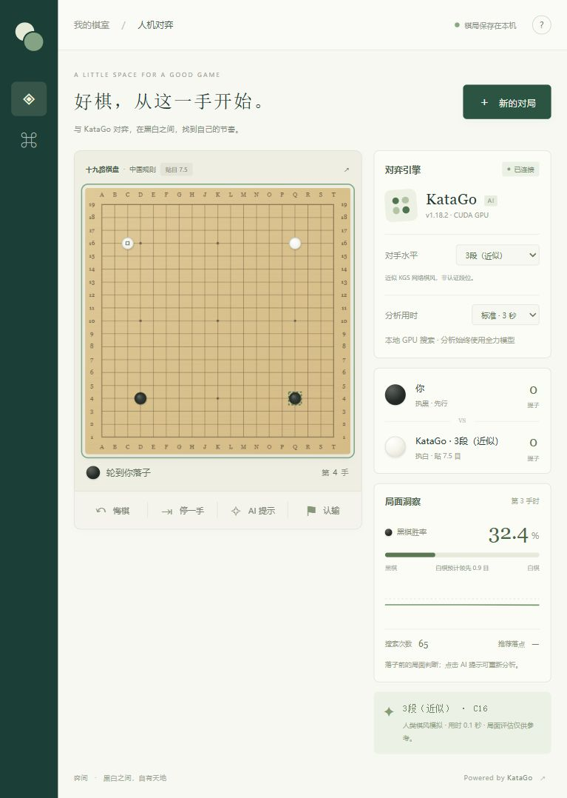

# Shiro Go · 弈间

**English** | [简体中文](README.zh-CN.md)

A local KataGo app with GPU acceleration, approximate rank opponents, AI scoring,
position analysis, and SGF export. All Go computation uses **your own computer**.
No account, API key, or paid inference service is needed.



## Download and run on Windows

1. Download **Shiro-Go-1.3.1-windows-x64.exe** from [Releases](https://github.com/billyzheng2410/shiro-go/releases/latest).
2. Double-click it. Your browser opens the local Go interface.
3. On first launch, choose a compute backend and click **Install and start**.
   The app downloads and verifies KataGo, models, and any needed GPU libraries.

The EXE includes Node.js. You do not need to install Node.js, Python, or a CUDA
toolkit. Internet is needed for initial downloads; play works offline afterward.
Use the top-right language selector to switch between Chinese and English.
Technical installation plans and logs are in English.

Windows x64 is supported. The EXE is currently **unsigned**, so Windows may show
an unknown-publisher warning. Check the repository source and the release's
`SHA256SUMS.txt`. Administrator privileges are not required.

Data defaults to `%LOCALAPPDATA%\ShiroGo`. You can choose a different model/runtime
directory during setup. The launcher selects an available local port, remembers
it, and reuses the running instance when reopened. **Quit app** stops the local
service; closing the browser tab alone leaves it running.

## Your CPU or GPU

| Backend | Hardware | Initial download |
| --- | --- | --- |
| Automatic | Compatible NVIDIA GPU, otherwise CPU | Depends on selection |
| CUDA | NVIDIA GPU, stronger main model | About 1.8 GiB |
| CPU | Local CPU, compact main model | About 114 MiB |

CUDA automatic selection requires at least 4 GiB VRAM, an NVIDIA driver compatible
with the pinned runtime (572.30+), and 8 GiB free on the target drive for first
installation. A larger runtime directory can be selected on another drive.
The installer does not change your drivers, system CUDA installation, or PATH.
CPU mode provides compatibility, with a smaller and weaker model than CUDA mode.

## Playing and analysis

- 9×9, 13×13, and 19×19 boards; either color; custom komi.
- Strongest KataGo search, plus HumanSL styles from **20 kyu to 9 dan**.
- 1, 3, 10, 30, or 60-second thinking budgets and cancellable searches.
- Undo, pass, resign, browser-local saving, and standard SGF export.
- Full-strength hints, win rates, estimated score leads, and variations.
- Free analysis mode: play for either side and request a fresh evaluation.

Rank options sample official HumanSL policies representing approximate KGS styles.
They are **not certified amateur or professional ranks**, and high-dan policy
sampling does not guarantee equivalent human playing strength. Small-board ranks
are experimental. Changing ranks affects subsequent opponent moves; hints,
analysis, and scoring always use full-strength search with the installed model.
Maximum strength depends on the model, hardware, and search time.

## AI scoring

Click **AI score** at any time after a move, or pass twice to start scoring
automatically. KataGo predicts ownership and suggests dead stones; the app then
counts Chinese area, including living stones, territory, and white's komi.
Click a group in the scoring board to toggle its life/death status, or reset to
the AI suggestion. This review does not remove stones from the actual game.

The dialog separates the **AI's predicted lead** from the **current area count**.
These can differ in unfinished positions. Dead stones, seki, ko, and unsettled
boundaries need review; finish the game and confirm the count together. The app
does not claim automatic tournament adjudication. Search estimates are not final
results. Rules use positional superko, no suicide, and 7.5 komi by default.

## Run from source

Install Node.js 20+ and download or clone the source:

```powershell
git clone https://github.com/billyzheng2410/shiro-go.git
cd shiro-go
npm run setup
npm start
```

There are no npm runtime dependencies; `npm install` is unnecessary for playing
from source. On Windows, `setup.cmd` and `start.cmd` provide the same workflow.
Keep the terminal open. Source mode defaults to `http://127.0.0.1:8765/` and stores
runtime files in `engine/`. Opening `dist/index.html` directly cannot reach KataGo.

```powershell
npm run setup -- --plan
npm run setup:cpu
npm run setup:cuda
npm run setup -- --runtime-dir "E:\GoRuntime"
npm run doctor
npm test
```

macOS and Linux require a manually installed native KataGo and models. Set
`KATAGO_PATH`, `KATAGO_MODEL`, `KATAGO_CONFIG`, and optionally `KATAGO_HUMAN_MODEL`.
The Windows EXE and automatic installer do not run on these operating systems.

## Build the EXE

On Windows x64:

```powershell
npm ci
npm run build:exe
npm run test:exe
```

The build verifies the official Node.js archive, embeds application assets using
Node SEA, and writes the EXE and checksums to `release/`. The opt-in EXE test uses
an isolated directory, removes Node from its PATH, downloads the CPU engine, and
verifies local play and scoring. Normal tests use mocked engines and download
nothing. CI checks Node 20/22 on Windows, macOS, and Linux.

## Troubleshooting and data

- Reopen the EXE if the page cannot connect. Source users should restart `npm start`.
- On installation errors, inspect the setup log and retry with CPU or a larger drive.
- Missing rank options usually mean the HumanSL model needs installation or repair.
- Source port conflicts can be resolved by setting `PORT` before `npm start`.
- First model/GPU initialization can exceed the selected thinking budget.

The server binds only to loopback and validates Host/Origin. Do not expose it
directly to the internet; it has no remote-user authentication. Games and searches
stay local. Setup downloads contact official GitHub, KataGo, and NVIDIA sources.
The interface has no remote fonts, analytics, or cloud inference.

Application code is MIT licensed. Engines, models, GPU libraries, and the embedded
Node runtime retain their own licenses. See [third-party notices](THIRD_PARTY_NOTICES.md).
