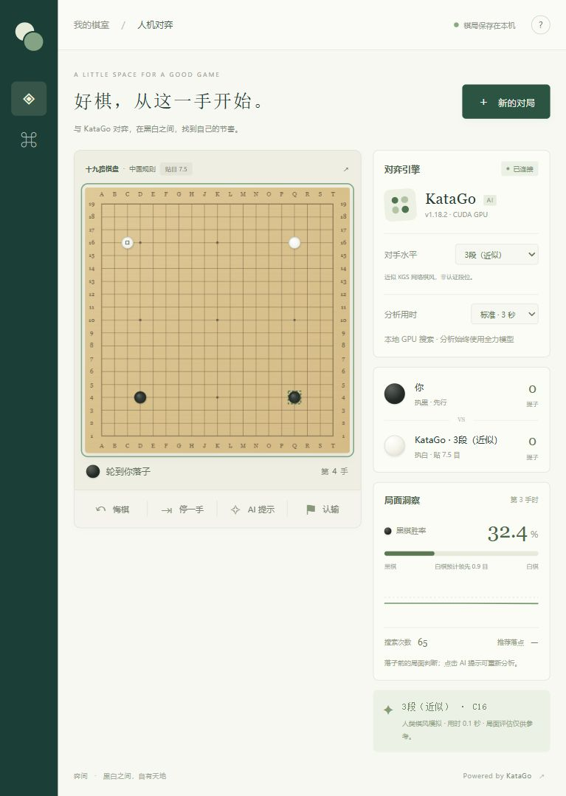

[English](README.md) | **简体中文**

# 弈间 · Shiro Go

**下载到自己的电脑，用自己的 CPU／NVIDIA GPU 下围棋。**

Shiro Go is a local KataGo GUI with CUDA acceleration, HumanSL rank opponents,
position analysis, and SGF export. All Go inference runs on the downloader's
own computer. No account, API key, paid inference API, or remote AI server is required.



## Windows EXE（无需安装 Node.js）

1. 打开 [Releases 下载页面](https://github.com/billyzheng2410/shiro-go/releases/latest)，下载 **Shiro-Go-1.3.0-windows-x64.exe**。
2. 双击 EXE，浏览器会自动打开本机围棋页面。
3. 首次运行在页面选择计算方式，点击「安装并开始」。引擎、模型和运行库由程序自动下载、校验；以后可离线使用。

EXE 已内置 Node.js，无需另装 Node.js、Python 或 CUDA 工具包。它使用下载者自己的 CPU／NVIDIA GPU；需要已有可用的显卡驱动。默认数据位于 `%LOCALAPPDATA%\ShiroGo`，首次安装也可选择模型存储目录。EXE 版本自动选择空闲端口并记住地址；再次打开会复用现有进程。网页右上角「退出应用」停止本地服务，关闭网页本身不会停止后台程序。

当前提供 **Windows x64** EXE，尚未做代码签名，Windows 可能显示发布者未知；请核对仓库来源和 Releases 的 SHA256SUMS.txt。当前用户权限即可使用，无需管理员权限。引擎安装计划与日志保留技术英文；游戏界面可在右上角切换中文／English，偏好会保存。

## 从源码启动

自动安装器目前支持 **Windows x64**。先安装 [Node.js 20 或更新版本](https://nodejs.org/)。

1. 点击本页 **Code → Download ZIP**，将压缩包完整解压；也可使用下方 `git clone`。
2. 双击 **`setup.cmd`**（或 `安装引擎.cmd`），等待首次引擎、模型下载完成。
3. 双击 **`start.cmd`**（或 `启动围棋.cmd`），浏览器会打开 **http://127.0.0.1:8765/**。

保留启动窗口；关闭窗口或重启电脑后，需要重新运行 `start.cmd`。这是在你电脑上运行的本地应用。GitHub 仓库用于下载源码，AI 对弈由本机服务提供。

命令行方式：

```powershell
git clone https://github.com/billyzheng2410/shiro-go.git
cd shiro-go
npm run setup
npm start
```

应用没有 npm 运行时依赖，无需执行 `npm install`。首次安装需要网络；安装完成后可离线对弈。模型及运行库在安装时从官方来源下载，不包含在 Git 仓库里。

## 用哪种本地算力

安装器会检查平台、本机 NVIDIA 显卡和目标盘空闲空间：

| 模式 | 使用的硬件 | 说明 |
| --- | --- | --- |
| `auto`（默认） | 合适的 NVIDIA GPU，否则 CPU | 自动选择，并解释选择原因 |
| `cuda` | 兼容的 NVIDIA GPU | 原生 CUDA／cuDNN，使用较强的主模型 |
| `cpu` | 本机 CPU | 兼容性优先，使用较小主模型；搜索速度通常更慢 |

CPU 首次下载约 **114 MiB**，CUDA 版约 **1.8 GiB**。CUDA 首次安装需要目标盘至少 **8 GiB 空闲**，还需要兼容 CUDA 运行库的 NVIDIA 驱动。安装器只下载应用自己的运行库，不修改系统驱动、CUDA 安装或 PATH。没有合适显卡、驱动或磁盘空间时，可使用 CPU 模式。

```powershell
# 只查看计划，不下载模型、运行库或创建配置：
npm run setup -- --plan

# 明确使用 CPU：
npm run setup:cpu

# 明确使用 NVIDIA CUDA：
npm run setup:cuda

# 将运行库和模型放在空闲较多的位置；路径由你选择：
npm run setup -- --runtime-dir "E:\GoRuntime"
```

默认下载和本地配置位于项目的 `engine/`，已被 Git 忽略。使用外置目录时，请保留该目录；`engine/active.json` 记录当前本机路径，迁移目录后需要重新配置。安装日志会给出准确下载项、选择结果和错误原因。

**macOS／Linux：** 当前不提供自动引擎安装。熟悉 KataGo 的用户可自行安装对应平台的原生引擎和模型，再通过下方环境变量配置；界面和协议测试会在多平台 CI 中运行，这不代表所有硬件后端均已实测。

## 功能和对手水平

- 9／13／19 路棋盘，执黑或执白，自定义贴目。
- 最强 KataGo 对手，以及 **20 级至 9 段**的人类棋风选项。
- 1／3／10／30／60 秒思考预算；可停止思考并继续使用热引擎。
- 悔棋、停一手、认输、浏览器本地保存、标准 SGF 棋谱导出。
- AI 推荐点、黑棋胜率、预计目差、参考变化和胜率走势。
- AI 自动数子、死子建议、可手动修正的归属图，以及中英文界面。
- 分析模式可为双方落子；AI 提示和局面分析始终使用主模型的全力搜索，不受对手段位限制。

人类档位使用官方 **HumanSL** 模型，以相应 KGS 档位的实际落子概率采样，并过滤非法着法；主模型搜索用于停手检查。中途调整档位只影响后续 AI 落子。

**这些档位是近似 KGS 棋风，不是中国业余段位证书或职业段位。** 高段原始策略采样不保证达到对应玩家经过读棋后的实战棋力。9／13 路的 HumanSL 档位为实验性模仿，段位未校准。各电脑的最强档棋力也受模型、思考预算和实际算力影响。

规则采用中国面积计分、全局同形、禁止自杀，默认白棋贴 7.5 目。

## AI 自动数子

点击棋盘下方「AI 数子」，或双方连续停一手后自动分析。始终调用全力 KataGo，按照 ownership 预测建议死子，再按中国面积规则计算黑白活子、围空和贴目。结果窗口显示 AI 预计领先、当前盘面计数和归属图；点击棋块可整块切换死活，点击「恢复 AI 判断」还原自动标记。修正只影响本次数子，不会删除对局棋子。

**数子是辅助判断，需要双方确认。** 未下完时 AI 预计领先与当前盘面面积可能不同；双活、劫争及低置信度死活会影响结果，应先收完并复核。所有中盘胜率和预计目差都是估计。数子使用所选思考时间，与对手段位无关。

## 运行方式与数据

浏览器连接本机 `127.0.0.1:8765`，Node 服务在本机启动 KataGo 子进程，模型在本机 CPU／GPU 上计算。棋谱和请求不会发送到本项目的远端服务器。界面不加载远程字体、分析追踪或云端推理服务。

安装阶段会连接 GitHub、KataGo 官方模型站；CUDA 模式还会连接 NVIDIA 官方运行库地址。点击界面的外部参考链接会访问对应网站。棋局自动保存在当前浏览器的本地存储中。

服务只监听回环地址，并校验 Host／Origin。不要将它通过端口转发或反向代理直接暴露到互联网；本应用不提供远程访问认证。

## 排查打不开的问题

先启动 `start.cmd`，然后访问 http://127.0.0.1:8765/。直接双击 `dist/index.html` 无法连接本机引擎。

```powershell
npm run doctor
```

- 页面无法连接：检查启动窗口是否仍在运行，或重新运行 `npm start`。
- 页面能打开但引擎未安装：执行 `npm run setup`，完成后重启服务。
- CUDA 失败：查看驱动／磁盘空间说明，或使用 `npm run setup:cpu` 后重启。
- 段位选项不可用：检查 HumanSL 模型是否完整，重新运行安装器修复。
- 默认端口被其他程序占用：设置 `PORT` 后启动，使用终端打印的新地址。

```powershell
$env:PORT = '8766'
npm start
```

熟悉 KataGo 的用户可设置 `KATAGO_PATH`、`KATAGO_MODEL`、`KATAGO_CONFIG`、`KATAGO_HUMAN_MODEL`，指定本机引擎、主模型、配置和 HumanSL 模型的绝对路径。自备配置应包含 `reportAnalysisWinratesAs = SIDETOMOVE`，使胜率方向一致。

## 开发和验证

```powershell
# 规则、协议、段位采样、取消和安装规划测试；无需模型或 GPU：
npm test

# 已安装引擎后，执行真实 9／13／19 路搜索：
npm run test:katago

# 已安装主模型及 HumanSL 后，检查段位策略与取消后的热进程复用：
npm run test:ranks
```

参考实现曾在 RTX 4060 Laptop 上测试 CUDA／cuDNN 的不同线程与批次，并比较 TensorRT。在三个固定 19 路局面、每局 3 秒预算下，双模型 CUDA 配置平均约 645 次搜索访问／秒，旧 DirectML 配置约 20 次／秒。这是该设备的一组搜索速度观测，不是所有下载者的性能或棋力保证。可用 `scripts/benchmark-gpu.mjs` 对自己的硬件进行测量。

## 许可证与来源

本应用源码使用 [MIT](LICENSE) 许可证。KataGo、模型和 NVIDIA 运行库各自适用上游许可证，详见 [THIRD_PARTY_NOTICES.md](THIRD_PARTY_NOTICES.md)。仓库不附带这些第三方二进制或模型权重。

- [KataGo](https://github.com/lightvector/KataGo)
- [官方主模型](https://katagotraining.org/networks/)
- [HumanSL 与额外模型](https://katagotraining.org/extra_networks/)

This is an independent local GUI, not an official KataGo or NVIDIA product.
